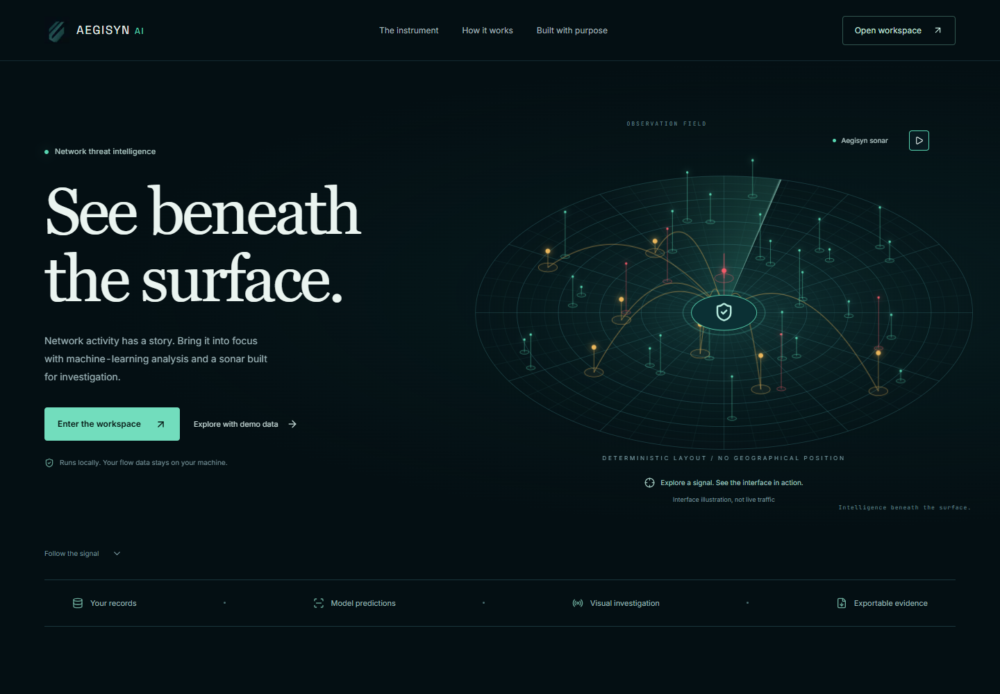
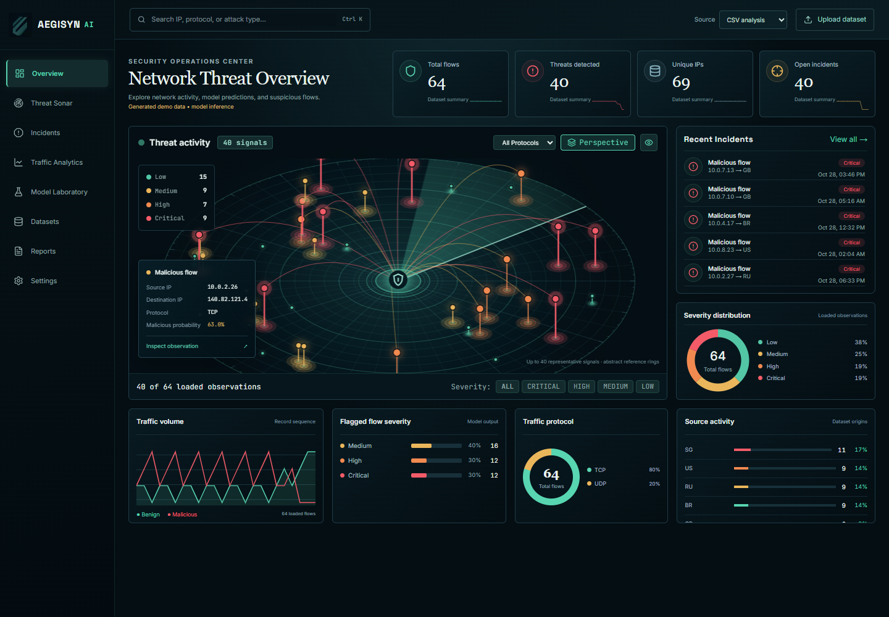
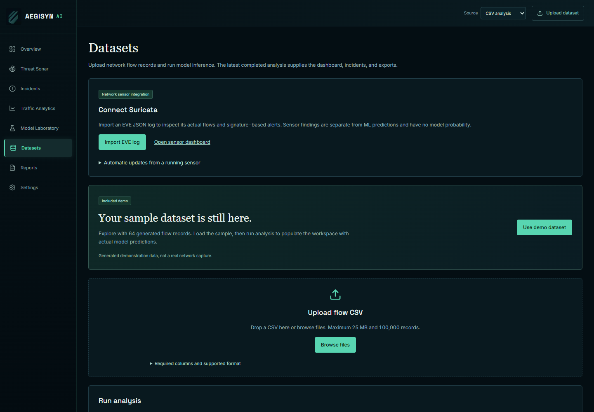

# Aegisyn AI

**Detect the unseen.** A local network-flow analysis workspace with machine-learning classification, an interactive sonar, incident investigation, and CSV exports.

Aegisyn analyzes recorded CSV data and can continuously read real Suricata EVE logs. Packet capture runs in Suricata separately; Aegisyn does not block traffic.

## Start from the terminal

Open PowerShell in the project folder and run:

```powershell
cd D:\Aegisyn-AI
npm start
```

This starts the website and Python analysis service together and opens the correct address in your browser. The launcher finds free ports and connects the services automatically. There is no need to change URLs or backend ports manually.

You can also double-click **Start Aegisyn.cmd**. Leave its terminal running while using the app. Press **Ctrl+C** to stop it. Running the same command again reuses a healthy running instance.

For development with automatic page updates:

```powershell
npm run dev
```

Stop an existing production launcher before switching to development mode. To rebuild after changing application code:

```powershell
npm run build
npm start
```

The launcher prefers website port **3002** and backend port **18152**, then chooses free alternatives if needed. Always use the address it prints or opens. Production API connections are resolved at runtime, so they follow the automatically selected backend port too.

### First-time setup

Install Node.js/npm and Python, then run these commands once from the project folder:

```powershell
npm install
python -m venv venv
.\venv\Scripts\python.exe -m pip install -r requirements.txt
npm start
```

The first production build is created automatically if missing. The bundled model artifacts must be present in `models/`. No login, cloud account, or paid service is required.

## Website preview

These screenshots show three different pages of the running application.

### Landing page



### Overview dashboard



### Datasets page



## Page-by-page guide

### 1. Landing page — `/`

The introduction to Aegisyn: its purpose, local workflow, and model limitations. The sonar illustration is interactive: select a signal to inspect its illustrative severity, or pause the sweep. It is clearly marked as an illustration rather than live traffic.

Use **Enter the workspace** to open the overview, or **Explore with demo data** to go directly to the included demo. The workflow section links to datasets, the sonar, and exports.

### 2. Overview — `/overview`

The main workspace combines:

- **Summary metrics:** analyzed flows, model-flagged flows, distinct available IPs, and open incidents for the latest completed analysis.
- **Observation field:** up to **40 representative observations**, selected with a stable pseudo-random sample from loaded observations, with no equal per-level quotas. All signals appear immediately. Sampling never changes a record's probability or severity.
- **Four-level legend:** low, medium, high, and critical are displayed separately.
- **Investigation:** hover over a signal for its record attributes; select it to open a detailed investigation drawer. A keyboard-accessible observation selector is also available.
- **Recent incidents:** open flagged records for review.
- **Charts:** severity distribution, traffic volume by record sequence, protocol shares, and source activity where the data provides it.
- **Search:** filter loaded observations by IP, protocol, record identifier, or classification.

The dashboard identifies generated demo data explicitly. An empty workspace provides direct links to the demo and CSV upload instead of inventing results.

### 3. Threat Sonar — `/threat-map`

A larger view of the same recorded observations. All selected signals are visible immediately. Filter by protocol or severity, hide benign flows, or switch between perspective and tactical projections. There are no playback, restart, or speed controls.

The sonar shows at most **40 signals** to keep the field readable. Its positions are deterministic abstract coordinates, not geographical locations or physical distances. Headline statistics and exports still cover the complete analyzed dataset.

### 4. Incidents — `/incidents`

Review model-flagged records with their available network attributes, probability, severity, timestamp, and investigation status.

Search and filter by status or severity, and browse results in pages of 25 rows. Select **Triage** to update a record to **New**, **Investigating**, **Reviewed**, or **Dismissed**, and save analyst notes. Changes persist in SQLite. Save failures are reported rather than presented as success.

Investigation dialogs support keyboard navigation, focus containment, and Escape to close.

### 5. Traffic Analytics — `/traffic-analytics`

Inspect aggregate statistics for the loaded observations: average flow duration, packet count, TCP share, and flagged-flow count. Charts summarize record-sequence traffic, flagged-flow severity, protocols, and available source-country metadata.

Up to 2,000 records are loaded for chart analysis; this analytical loading limit is separate from the sonar's 40-signal display cap. Chart captions explain their scope. Missing metadata is shown as unavailable rather than fabricated.

### 6. Model Laboratory — `/model-laboratory`

View saved evaluation results for **Random Forest**, **Logistic Regression**, and **Histogram Gradient Boosting**. Results include accuracy, precision, recall, F1, ROC AUC, PR AUC, held-out classification counts, training/test sample counts, and saved inference latency.

The installed models were trained and evaluated on generated demonstration data. Their evaluation scores do **not** establish detection accuracy on real network traffic.

### 7. Datasets — `/datasets`

Choose the included compact demo or upload a compatible flow CSV. Select a model and run analysis. Job completion and failures come from the backend, rather than a simulated progress timer. The latest completed job supplies the other workspace pages.

The included demo contains **64 generated flows**. With the bundled Random Forest model, actual inference yields:

- **24 low-severity flows**.
- **16 medium-severity flows**.
- **12 high-severity flows**.
- **12 critical-severity flows**.

There are **40 model-flagged flows** in total. The four severity groups are selected using the model's actual probabilities; predictions are never overwritten to force the visual distribution. Other models may produce different scores and counts.

The compact demo lives in `fixtures/demo-flows.csv`, with its generation details in `fixtures/demo-manifest.json`. Its source examples are synthetic. The original larger sample and prior analyses are retained separately; they are not silently substituted into the active view.

### 8. Reports — `/reports`

View the latest completed analysis and download its saved predictions as a CSV. The export includes every analyzed record, available original network attributes, malicious probability, predicted class, and severity.

Exports are not restricted to the 40 sonar signals or the 2,000 chart-loaded observations. Text fields are escaped against spreadsheet-formula injection. No completed analysis means no fabricated report or sample download.

### 9. Settings — `/settings`

Save scan-animation, projection, and benign-observation visibility in this browser. These preferences apply when opening the sonar. Probability thresholds are fixed and are not presented as nonfunctional settings.

## Classification and severity

Binary classification and severity are separate:

- A record is **flagged** when its malicious probability is at least **0.50**.
- **Low:** below 0.40.
- **Medium:** 0.40 up to, but excluding, 0.65.
- **High:** 0.65 up to, but excluding, 0.85.
- **Critical:** 0.85 and above.

These bands describe model probability, not validated operational impact. A medium-severity record below 0.50 can still be classified as benign. Uploaded data is never forced to contain every severity level.

## CSV input requirements

Uploads must contain **1–100,000 rows**, be no larger than **25 MB**, and include the following numeric model features:

```text
dur, sbytes, dbytes, spkts, dpkts, sttl, dttl, sload, dload,
smeansz, dmeansz, sjit, djit, tcprtt, synack, ackdat,
ct_srv_src, ct_srv_dst, ct_dst_ltm, ct_src_ltm
```

Required categorical features: `proto`, `service`, and `state`. Numeric values must be finite and nonnegative.

Supported aliases are `smean` → `smeansz`, `dmean` → `dmeansz`, `srcip` → `src_ip`, `dstip` → `dst_ip`, and `dport` → `port`. Protocols are normalized to uppercase.

Optional metadata includes `id`, `src_ip`, `dst_ip`, `port`, `timestamp`, `country`, and binary `label`. Labels and attack-category metadata are not model inputs. Other CSV schemas need to be mapped to this feature set before upload.

## Data and implementation

- **Interface:** Next.js, React, TypeScript, SVG, and Canvas 2D.
- **Analysis:** local FastAPI service and scikit-learn model inference.
- **Persistence:** uploaded CSVs and a local SQLite database in `data/`.
- **Model artifacts:** `models/`.
- **Compact generated demo:** `fixtures/`.
- **Automatic service discovery:** ignored `.aegisyn/runtime.json`.

The ML workflow classifies recorded flows as benign or malicious. It does not claim named attack-family prediction, packet capture, network blocking, or SHAP explanations. Real-traffic performance has not been validated for the bundled demonstration-trained models. The separate Suricata source displays actual sensor signatures and priorities and automatically ingests new log records.

## Verification commands

```powershell
npm run lint
npm test
npm run test:startup
npm run build
.\venv\Scripts\python.exe -m unittest discover -s test -p backend_data_test.py -v
```

The checks cover coordinate determinism, the 40-signal stable randomized sampler, model-output integrity, compact-demo counts, input validation, repeated analyses, and automatic port/service discovery. Browser checks also cover observation filters, investigation dialogs, exports, and responsive layouts.

To regenerate the compact demo from the retained generated source and installed Random Forest artifact:

```powershell
.\venv\Scripts\python.exe -m ml.build_demo
```

This selects synthetic feature combinations by actual inference scores; it does not edit prediction probabilities.

## Connect a real Suricata sensor

Aegisyn supports **Suricata EVE JSON-lines logs** as a separate data source. It does not install Suricata or capture packets itself. Run Suricata separately on your network sensor and connect its EVE output using either method below.

### Import an existing log

1. Open **Datasets → Connect Suricata**.
2. Select **Import EVE log** and choose `eve.json`, `.jsonl`, or `.log` (maximum 25 MB).
3. The importer accepts `alert` and `flow` records, validates their timestamps/IPs, reports unsupported event types, and skips duplicate records.
4. Select **Open sensor dashboard**. The header source selector switches between **CSV analysis** and **Suricata sensor** throughout the workspace.

Sensor records go directly into the observation store. They are not padded with missing model features or run through the demonstration classifier.

### Watch a log continuously

By default, Aegisyn reads `data/eve.json` in this project once per second. Configure your sensor to write or mirror its EVE log to that path. For another accessible local log path, set the following before startup:

```powershell
$env:AEGISYN_EVE_PATH = 'C:\Suricata\log\eve.json'
npm start
```

Use a real existing path from your installation. The configured path is shown under **Datasets → Connect Suricata → Automatic updates**. A sensor on another machine must mirror or forward its log onto an accessible local file; this milestone does not provide a remote log receiver.

The watcher reads complete appended lines, retains unfinished lines until they are complete, saves its byte position in SQLite, and detects truncation/replacement. Identical records are deduplicated across uploads, restarts, and log rotation. Oversized or malformed watched lines are skipped and counted; an invalid uploaded file is rejected before any records are inserted.

When **Suricata sensor** is selected, the header checks for newly stored records every two seconds. The overview, sonar, incidents, and analytics refresh automatically when the record revision changes. “Watching EVE log” means the local reader is active; it does not claim that Aegisyn is capturing traffic. Missing files show “Waiting for EVE log.” Connection and read failures are shown explicitly.

### How sensor findings are represented

- Sensor alerts display their original signature, category, flow ID, timestamp, and priority.
- Suricata priority **1 maps to high**, **2 to medium**, and **3/4 to low**. Critical is not invented to fill a visual category.
- Plain flow records are unclassified observations. The absence of an alert does not establish that traffic is benign.
- Sensor records have **no ML probability**. The investigation drawer and incident table identify them as sensor findings.
- Counts represent EVE observations and alerts, not unique network sessions. Flow and alert records can share the same flow ID.
- Review status and analyst notes persist for sensor alerts. **Reports** exports sensor records, priorities, signatures, and notes separately from model predictions.
- The existing 40-signal visual cap and deterministic sampling still apply; counters and exports cover the stored source.

No sensor data is fabricated when no log is connected. The bundled generated demo remains available under CSV analysis. Retraining a model on validated sensor-compatible features is a separate step; imported Suricata alerts are not used as proof of the existing model’s accuracy.

Reference: [Suricata EVE JSON documentation](https://docs.suricata.io/en/suricata-7.0.11/output/eve/eve-json-format.html).
